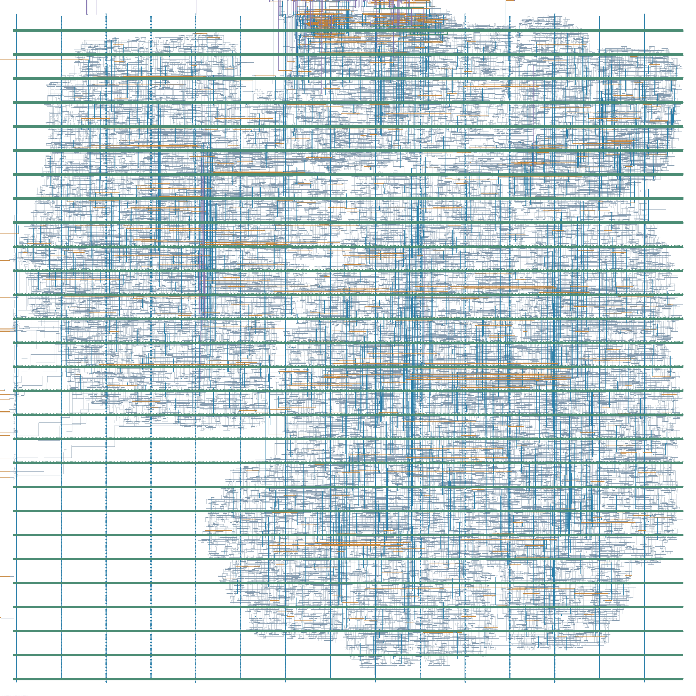
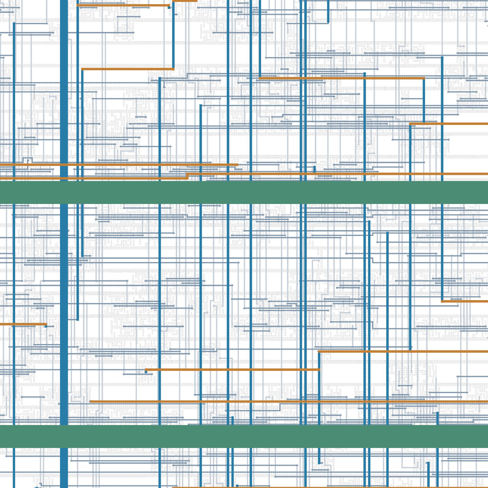

# Frozen V3: UCSB routed results (2026-10-12)

**All executed stages and supported qualification checks PASS.** This is a new
revision, bound to the final integrated RTL closure and newly qualified input
checkpoint. The archived results under `physical/` remain historical records.
Their pins, templates, manifests and acceptance checks were not rewritten.

## Profile, stages and repair

DATA_WIDTH=16, AXI data/address/ID=32/32/4, S_AXI_ADDR_WIDTH=8, MAX_LEN=256,
BURST_LEN=16, MAX_OUTSTANDING=8; bus10ns / MAC7.5ns. The run starts from the
[electrically qualified UNPLACED checkpoint](../evidence/qualified-frozen-20261012.json),
not the superseded qualified6 checkpoint.

| Stage | Accepted result and recorded repair |
|---|---|
| Floorplan / PDN setup | PASS; 298 rows, VDD/VSS connections checked |
| Placement | PASS; overlap/row/site/spacing violations=0 |
| CTS | PASS after 15 additional hold buffers; initial bus hold −0.063 ps / one endpoint failure retained |
| Global / detailed route | PASS; congestion=0 at GRT; final router DRC report empty, routing completeness=1 |
| Filler / finish / OpenRCX | PASS; 40,301 fillers, actual routed SPEF; initial Qt image failure retained and resolved using existing plugin path |
| GDS / supported rules | PASS; master mapping has no orphans; 133 KLayout categories complete, DRC/operative antenna markers=0 |
| Final STA / CDC / mapping | PASS; matching native OpenROAD and standalone OpenSTA inputs, exact clock-domain identity and constrained functional endpoints |
| Final mapped GLS | 7 original top-level cases + 2 DMA fault/recovery jobs PASS; final functional netlist is byte-identical to the tested antenna-repair GRT netlist |

The first routed GDS failed four operative antenna markers, all on the bus input
clock net. Actual polygon/net correlation identified the long wire to the CTS
root. A new physical variant inserted three identity CLKBUF_X3 cells, followed
by legalization, routing, hold repair, extraction, STA, GLS and the complete GDS
check. The second GRT repair added 289 data hold buffers. The failed first GDS
and its reports remain in the external archive. No RTL or timing/I/O/CDC contract
was changed; no nonzero marker report was accepted.

## Final metrics and verification boundary

| Metric | Final value |
|---|---:|
| Standard cells / FFs | 29,002 / 7,509 (bus 7,287; MAC 222) |
| Standard-cell area | 69,034.714 µm²; LEF master geometry, taps/fillers excluded |
| Core area / utilization | 174,468.868 µm² / 39.5685% |
| Die area / dimensions | 188,772.8704 µm² / 434.48 × 434.48 µm |
| Total instances / taps / fillers | 70,349 / 1,046 / 40,301 |
| Bus setup / hold WNS | +7.551700 ns / +74.356 ps |
| MAC setup / hold WNS | +5.978773 ns / +82.133 ps |
| Setup/hold TNS / violating endpoints | 0 ns / 0, both domains |
| Slew / fanout / capacitance violations | 0 / 0 / 0 |
| Router DRC / supported KLayout DRC / operative GDS antenna | 0 / 0 / 0 |

Nangate45 typical 1.1 V / 25 °C, propagated clocks and routed OpenRCX SPEF;
original I/O/reset/CDC assumptions, zero clock uncertainty. Native and independent
STA read identical final Verilog/SDC/SPEF bytes. Active unannotated drivers=0 and
partial annotation=0; 8,261 unused/unloaded drivers are classified explicitly.

Mapping preserves 7,509 FF clock roots, with no unmapped cells or latches.
There are 13 two-stage synchronizer chains, 602 bounded crossing pairs, three
first-stage event exceptions and 26 active interstage checks. Coverage includes
104 input and 93 output bits with min/max constraints; unconstrained functional
endpoints=0. Reset arrival/recovery/removal/RDC are excluded by the documented
safe external release contract. Route completeness, router opens/shorts checks
and PG connectivity do not constitute LVS.

KLayout supported-rule checks and operative GDS antenna passed. **Native LEF
antenna remains INCONCLUSIVE; qualified LVS is UNSUPPORTED.** The GLS is
zero-delay, not SDF or LEC. No multi-corner/OCV, foundry signoff, full-top formal
equivalence, MTBF/RDC, dynamic IR/EM or signoff power is established. PDNSim used
only default activity/static nominal assumptions; unpopulated GUI heatmaps are
not claimed as measured results.

## Source and artifact identity

[Publication binding](../evidence/routed-20261012/binding.json) seals the compact
result, mapping, CDC, coverage, GDS-check records and layout images independently
from the historical pins. [Results record](../evidence/routed-20261012/results.json)
retains the original external manifest hash, archive identity, input checkpoint,
final netlist GLS binding, tool versions and source hashes.

Qualification source manifest SHA-256:
`706323b65d6a4bd6da3ebdbcaea053ebbc78e88fa5b6c05d699c3f5a847a993d`.
The publication RTL and all 43 frozen functional inputs match the closure.
The broader prequalification source inventory includes then-current documents;
those archived document hashes are historical inputs, not a claim that rewritten
publication prose was used by synthesis.

| Final artifact | SHA-256 |
|---|---|
| `gds` | `b7dec1a5900ff5ca5816f6a2141bbd3a3a75788b118fbb6fd681fc42cdf3fdb0` |
| `odb` | `ffc3cb61026d80b01322ac69f01fce04bb3910bb2cc3a73d0a0613d2940a0f01` |
| `v` | `45300ee7636ea81a9bc5cebbc2eab3656fb1fc273a111b714b3ab6406b706a73` |
| `sdc` | `753f0ea4f6f07fdc864692cad92a5a9d192bb0fbc95babae4ece5bd9a1511e1e` |
| `spef` | `7a8d6629207b787ba9dceccce38fbd45704d3d6bec49977e8ef6bb258395c9d7` |
| `def` | `8c9fd9585e93f2db9a57e559daa46895d37407b450ed6d411291b1e9d7153498` |

Serialized final SDC includes propagated-clock state and has its own artifact
hash. Its coverage was checked against the original timing contract; the seed
SDC hash remains in the separate pre-layout record.

## Reproduction

The full package stays outside Git:
`frozen-706323b6-ucsb-routed-final-r2.tar.gz`, 166,996,984 bytes, SHA-256
`a4465f189ef68a0c9d29907033d0546ca7a58641f5df24d534ef46f528300977`.
Its 794 files include final Verilog/SDC/ODB/SPEF/DEF/GDS, frozen inputs, platform
and ORFS inputs, exact stage drivers, failed attempts and raw reports.
No remote/local account paths are needed by the public result record.

Read-only checks from the repo root:

```bash
python3 scripts/check_publication.py
python3 scripts/check_publication.py --archive /path/to/frozen-706323b6-ucsb-routed-final-r2.tar.gz
```

To inspect the package, extract into a **new** directory and run
`sha256sum -c SHA256SUMS` from `final-delivery` (macOS: `shasum -a256 -c SHA256SUMS`).
Exact execution recipes are in `evidence/driver`; p3/p4 `inputs` contain the
hydrated configs, guards and STA scripts. Copy/rebase experiment drivers into a
fresh root; they retain the original execution paths and must not overwrite the
preserved run. Use direct ORFS do-* targets and inspect dependencies to prevent
an unintended synthesis rerun. The sequence was floorplan → placement → CTS /
hold repair → global/detail route → filler/finish → extraction → GDS, with a
separate antenna-repair variant and renewed qualification. The historical
[reproduction flow](../physical/REPRODUCE.md) explains the tool/input adapter,
but its old accepted results cannot qualify this revision.

Tools: OpenROAD 26Q2-1164-g08f67ee5ec, OpenSTA 3.1.0, KLayout 0.28.17;
ORFS e5ce907f878490bf9947347f4cd4b73e97451c80. The matching OpenROAD build is
recommended for native ODB serialization. Verilog/SDC/SPEF remain independently
inspectable inputs. Heavy jobs ran one at a time, two CPUs; nice10 was requested,
with inherited effective NI19. Physical/GDS qualification took 2h12m; the
recorded run including backups, extraction verification and reporting took
2h21m34s. A fresh portable end-to-end replay remains untested.

## Layout views





Both images are exact copies of the externally sealed renderings, tied to the
final GDS hash. They are layout previews, not congestion/IR heatmaps.
