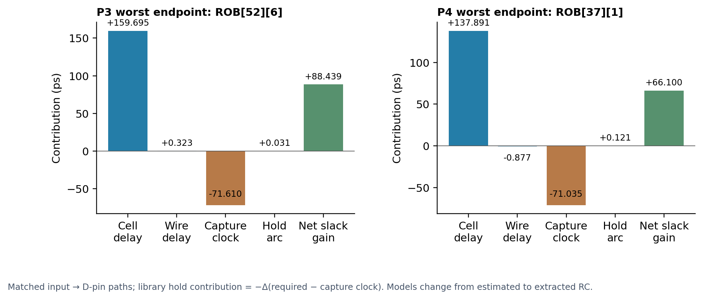

# Why bus hold improved after CTS

The stage minimum rises from **+0.954 ps at P3 CTS to +71.475 ps at P4 routed**, an improvement of **70.521 ps**. These minima belong to different paths:

- P3: `M_AXI_RDATA[6]` → `rob_data[52][6]/D`.
- P4: `M_AXI_RDATA[1]` → `rob_data[37][1]/D`.

Both endpoint names above abbreviate the `u_dma.u_read_engine` prefix and mapped FF suffix. Full names and five tracked paths across five preserved checkpoints are in [hold-analysis.json](hold-analysis.json). Comparing only WNS would obscure the endpoint change.

## Direct checkpoint evidence

| Transition | New standard cells | New hold buffers | Cell resizing | Existing standard cells moved |
|---|---:|---:|---:|---:|
| P3 CTS → first global route (`hold50`) | 135 | 135 | 0 | 327 |
| First global route → first final route | 0 | 0 | 0 | 0 |
| First final route → repaired global route (`antenna_split3`) | 274 | 271 | 0 | 493 |
| Repaired global route → final route | 0 | 0 | 0 | 0 |

The only 409 added standard cells are **406 hold buffers + three `antenna_busclk_*` clock buffers**. Final hold count = 595 + 135 + 271 = 1,001. Names, masters, position changes and path membership were read directly from the saved ODBs; repair logs independently corroborate insertions. The repaired seed starts from the first global-route ODB; comparing the first final-route cell inventory is valid because those inventories are unchanged. Position changes are counts per transition, not unique moved cells across the whole experiment.

The three clock-input buffers split a bus input wire that had four operative GDS antenna violations. They increase capture insertion delay, which **reduces** I/O hold margin for a fixed data arrival. The second global-route optimization then adds 271 data hold buffers. The 50 ps `HOLD_SLACK_MARGIN` is an optimization target; it does not change the SDC hold constraint. P3 CTS and P4 final SDCs are **byte-identical**, SHA-256 `753f0ea4f6f07fdc864692cad92a5a9d192bb0fbc95babae4ece5bd9a1511e1e`.

## Same-path accounting

For the tracked input-to-register paths with unchanged zero input-min delay:

`hold slack = data arrival − capture clock arrival − library hold requirement`

Read-only native STA loads each original ODB/SDC and its saved estimated or extracted SPEF; no cell repair or routing is executed. Consecutive input/output pins on the same instance identify cell delay; increments between instances identify wire delay. Values have 0.001 ps report resolution. The source-port point has no cell arc and is excluded from cell classification. Capture-clock arrival is read after saving all path scalars/points because the STA API invalidates path handles on another timing query.

| Matched endpoint | P3 hold (ps) | P4 hold (ps) | Δ data (ps) | Δ cell / wire (ps) | Δ capture clock (ps) | Δ library hold (ps) | Δ slack (ps) | Added hold cells |
| --- | --- | --- | --- | --- | --- | --- | --- | --- |
| rob_data[52][6]$_DFFE_PP_/D | 0.954 | 89.393 | 160.018 | 159.695 / 0.323 | 71.610 | -0.031 | 88.439 | 7 |
| rob_data[37][1]$_DFFE_PP_/D | 5.375 | 71.475 | 137.014 | 137.891 / -0.877 | 71.035 | -0.121 | 66.100 | 6 |

On the original P3 worst path, seven additional hold instances appear: `hold3441`, `hold3442`, `hold3443` (first route repair) and `hold3761`–`hold3764` (second repair). Every added instance is absent from the corresponding earlier ODB and present on the final timing path. Its **160.018 ps extra data delay** consists of **159.695 ps net increase in cell delay** and **0.323 ps in wire delay**. The capture clock is 71.610 ps later; the library hold arc changes by −0.031 ps. Net improvement: **88.439 ps**, to +89.393 ps.

On the final worst path, six additional hold instances appear: `hold3458`, `hold3459`, and `hold3626`–`hold3629`. Extra data delay is 137.014 ps, capture delay increases 71.035 ps, and the hold requirement falls 0.121 ps. Net improvement: **66.100 ps**, from +5.375 to +71.475 ps.

The evidence supports added hold-buffer chains as the dominant measured data-delay change on these paths. Existing cell delay also responds to changed slew/loading and estimated versus extracted RC; the net cell-delay increment cannot be assigned solely to the isolated intrinsic delays of newly inserted buffers. Routing changes the reported delay without changing cell inventories during detailed routing. This is an observational comparison, not a same-RC counterfactual experiment. No unsupported credit is assigned to clock-skew reduction: bus rise/fall global spreads actually increase slightly (29.336→30.850 ps / 31.013→32.518 ps).
