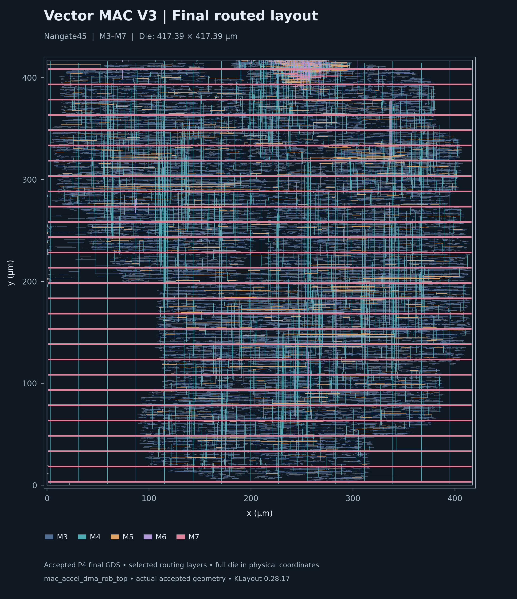
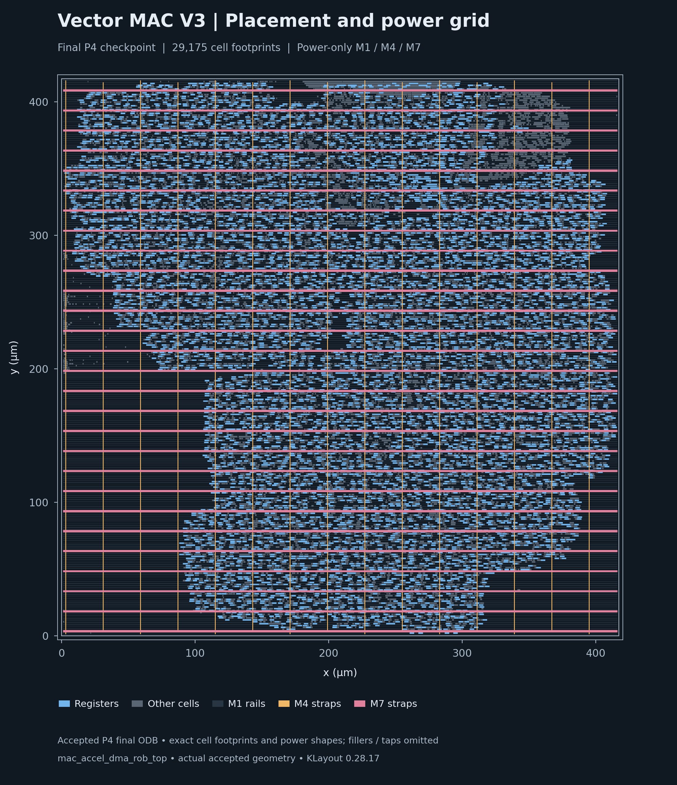
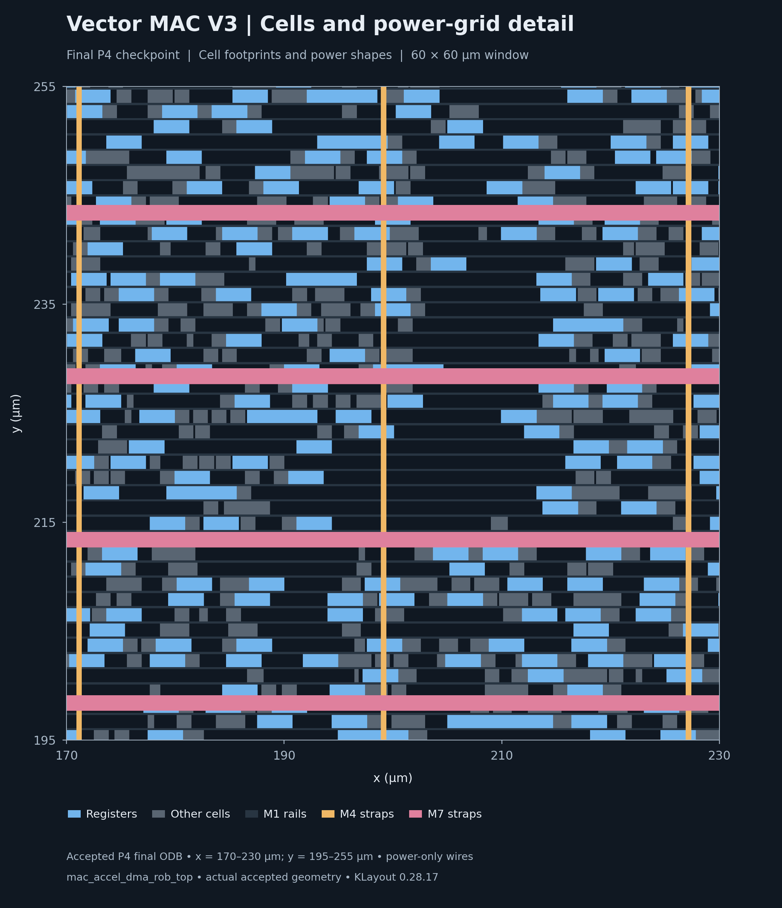

# Vector MAC V3 physical implementation

The complete `mac_accel_dma_rob_top` has a measured Nangate45 RTL-to-GDS research implementation. RTL was synthesized for Nangate45; the historical OSU 0.18 µm DC/PrimeTime implementation remains an independent baseline.

The signed 16-bit MAC receives ordered operand pairs through an asynchronous FIFO. AXI read DMA keeps eight bursts outstanding, accepts RID-indexed out-of-order responses into the ROB, and retires completed entries in issue order. AXI4-Lite handles control/status. Bus and MAC clocks are asynchronous, at **10 ns and 7.5 ns**.

*Actual accepted P4 GDS, full 417.39 × 417.39 µm die; M3–M7 selected
for readability. Lower metal, vias and FEOL are omitted from this overview.*

## Measured results

| Final measured result | Value |
|---|---|
| Standard cells / sequential cells | 29,175 / 7,503 |
| Standard-cell area / core area | 69,764.352 / 172,038.160 µm² |
| Standard-cell utilization | 40.552% (taps and fillers excluded) |
| Bus setup / hold worst slack | +7.583547 ns / +71.475 ps |
| MAC setup / hold worst slack | +6.012479 ns / +82.811 ps |
| Setup/hold TNS; electrical violations | 0 ns in both domains; 0 slew/fanout/capacitance |
| Supported router / KLayout DRC | 0 / 0 markers; 133 KLayout rule categories |
| Operative GDS antenna check | 0 markers after physical clock-input repair |
| CDC | 13 two-stage chains retained; 602 bounded crossings audited |
| Routed-netlist functional regression | 7/7 PASS, zero-delay |
| LVS | UNSUPPORTED: qualified infrastructure unavailable |

The timing uses extracted OpenRCX SPEF and propagated clocks, independently checked in standalone OpenSTA. These are single-corner research results at 1.1 V / 25 °C, with the preserved I/O/reset contract and zero clock uncertainty. Supported DRC success and timing margin do not establish foundry signoff, multi-corner closure, MTBF, RDC, or dynamic IR/EM.

## Evidence and reproduction

- [Measured PPA, clocks, timing and routing comparison](RESULTS.md)
- [CDC, verification and constraint methodology](METHODOLOGY.md)
- [Evidence-based bus hold analysis](HOLD_ANALYSIS.md)
- [Pinned reproduction requirements and commands](REPRODUCE.md)
- [Machine-readable results](summary.json), [CSV table](ppa.csv), [revision/source/PDK pins](pins.json)

The public package contains compact summaries, scripts and figures. Large GDS/ODB/DEF/SPEF and library files remain in the preserved evidence archive; artifact SHA-256 hashes are included in `summary.json`.

The repaired artifact acceptance path has passed read-only validation against the accepted P4 implementation, including positive and negative CDC/antenna controls. A fresh portable RTL-to-GDS stage replay remains untested. See the [tested scope and acceptance limits](REPRODUCE.md#experimental-adapter-acceptance-limits); any nonzero antenna marker now stops the flow for investigation.

## Placement and power distribution

*Accepted final P4 ODB: exact footprints of 29,175 standard cells, with
registers in blue and other standard cells in gray. M1 rails and M4/M7
power straps are overlaid; taps and fillers are omitted. This is a cell
placement and power-only geometry view; signal routes are not displayed.*

*Accepted final P4 ODB, x = 170–230 µm and y = 195–255 µm. Cell footprints
and power-only M1 rails, M4 straps and M7 straps show the grid at cell scale.
The view does not establish IR/EM or display detailed signal routing.*

For actual routed signal-metal geometry, see the
[main README routing detail](../readme.md#physical-implementation).
The [P9 figure manifest](figures/p9_provenance.json) records copied-image
hashes and visible layers. All original figures and their
[original provenance](figures/provenance.json) remain preserved.

## Verification limits

Qualified LVS is **unsupported**. Extracted timing is **single-corner**, with
zero clock uncertainty and the preserved I/O/reset contract. Native LEF
antenna checks are **inconclusive**; complete supported KLayout GDS checks
provide the operative antenna evidence. The tested artifact acceptance path
does not establish a fresh portable RTL-to-GDS replay, which remains
**untested**. Detailed measurement tables and limitations remain in
[RESULTS.md](RESULTS.md), [METHODOLOGY.md](METHODOLOGY.md), and
[REPRODUCE.md](REPRODUCE.md#experimental-adapter-acceptance-limits).
