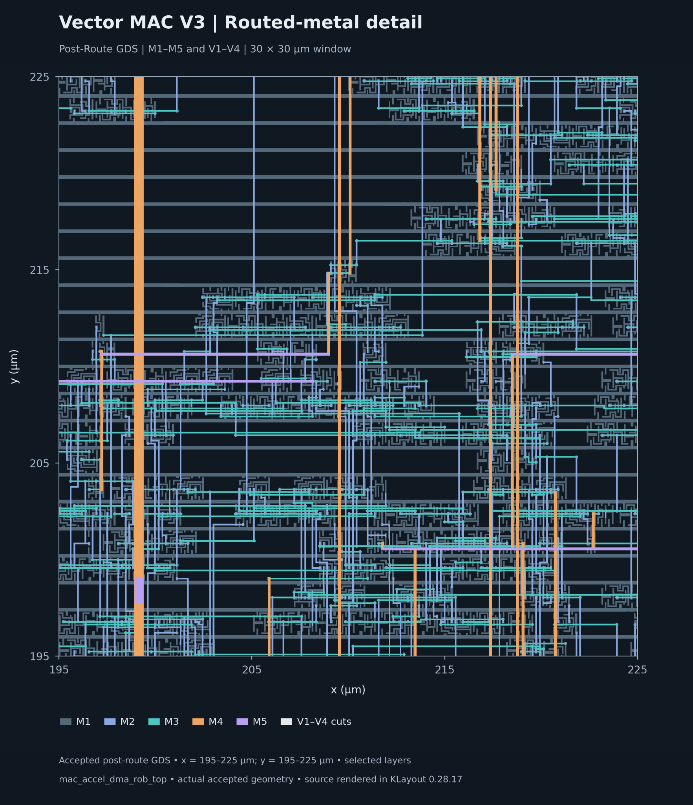
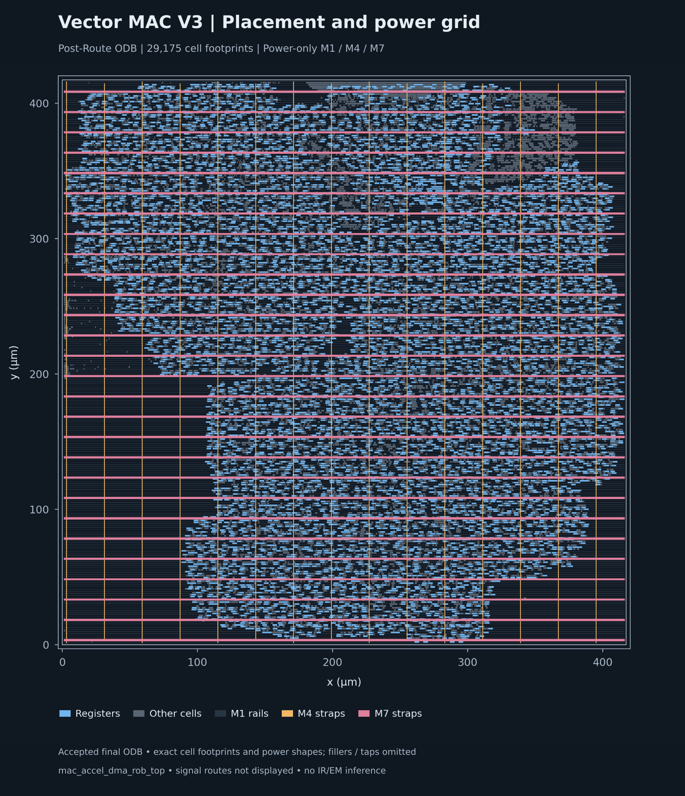
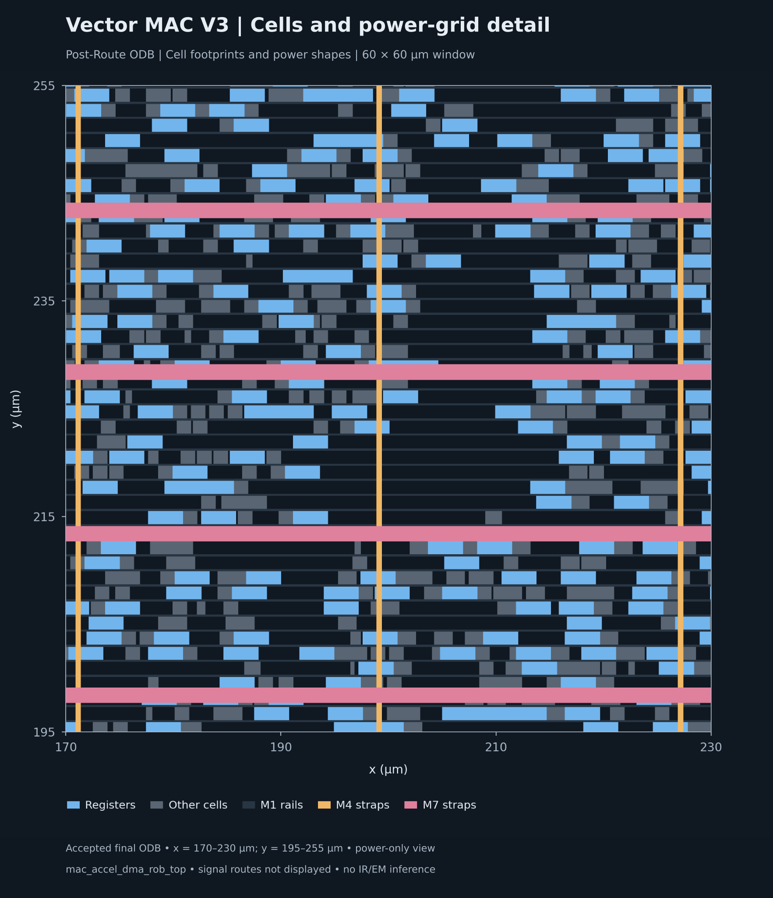

# Vector MAC V3 physical implementation

The complete `mac_accel_dma_rob_top` has a measured Nangate45 RTL-to-GDS research implementation. RTL was synthesized for Nangate45; the historical OSU 0.18 µm DC/PrimeTime implementation remains an independent baseline.

The signed 16-bit MAC receives ordered operand pairs through an asynchronous FIFO. AXI read DMA keeps eight bursts outstanding, accepts RID-indexed out-of-order responses into the ROB, and retires completed entries in issue order. AXI4-Lite handles control/status. Bus and MAC clocks are asynchronous, at **10 ns and 7.5 ns**.

*Actual accepted post-route GDS, full 417.39 × 417.39 µm die; M3–M7 selected
for readability. Lower metal, vias and FEOL are omitted from this overview.*

## Measured results

| Final measured result | Value |
|---|---|
| Standard cells / sequential cells | 29,175 / 7,503 |
| Standard-cell area / core area | 69,764.352 / 172,038.160 µm² |
| Standard-cell utilization | 40.552% (taps and fillers excluded) |
| Bus setup / hold worst slack | +7.583547 ns / +71.475 ps |
| MAC setup / hold worst slack | +6.012479 ns / +82.811 ps |
| Setup/hold TNS; electrical violations | 0 ns in both domains; 0 slew/fanout/capacitance |
| Supported router / KLayout DRC | 0 / 0 markers; 133 KLayout rule categories |
| Operative GDS antenna check | 0 markers after physical clock-input repair |
| CDC | 13 two-stage chains retained; 602 bounded crossings audited |
| Routed-netlist functional regression | 7/7 PASS, zero-delay |
| LVS | UNSUPPORTED: qualified infrastructure unavailable |

The timing uses extracted OpenRCX SPEF and propagated clocks, independently checked in standalone OpenSTA. These are single-corner research results at 1.1 V / 25 °C, with the preserved I/O/reset contract and zero clock uncertainty. Supported DRC success and timing margin do not establish foundry signoff, multi-corner closure, MTBF, RDC, or dynamic IR/EM.

### Physical design decisions and trade-offs

The configured inputs and repair guards below come from the accepted flow's
[hashed templates/platform pins](pins.json). OpenROAD determined placement,
clock-tree topology, sizing, repair cells and routes within that contract.

| Configured input or guard | Tool behavior and demonstrated trade-off |
|---|---|
| [Placement/CTS configuration](templates/p3/config.mk): `CORE_UTILIZATION=40`, `PLACE_DENSITY_LB_ADDON=0.20`; timing-/routability-driven placement enabled | Utilization drives floorplan sizing; the density addon is a separate placer control. OpenROAD derives the row/site-aligned floorplan and optimizes placement. **40% is an input**, while **40.552% is final measured standard-cell utilization** after physical repair; an optimal density is not established. |
| [SDC](templates/p2/constraint.sdc): bus 10 ns / MAC 7.5 ns, I/O min 0 / max 1 ns, no added uncertainty; targeted CDC bounds/exceptions | Timing repair operates under fixed budgets. Synchronizer interstages remain timed; asynchronous grouping does not blanket-exclude all crossings. Positive extracted margins apply to this single-corner contract. |
| [Synchronizer guards](templates/p3/repair_guard_pre.tcl) and [checkpoint audits](templates/p3/repair_guard_post.tcl); `SKIP_GATE_CLONING=1` | Protection is temporarily released for physical repair/PG connections, then identities, direct chains and clock assignments are checked and protection restored. Physical repair freedom is constrained by retaining all 13 two-stage chains. |
| Inherited Nangate45 [M1/M4/M7 PDN strategy](https://github.com/The-OpenROAD-Project/OpenROAD-flow-scripts/blob/e5ce907f878490bf9947347f4cd4b73e97451c80/flow/platforms/nangate45/grid_strategy-M1-M4-M7.tcl) | The platform supplies rail/strap geometry; PDN generation creates the shapes/connections. PG connectivity checks pass, but do not establish IR/EM performance. This is an inherited platform grid. |
| [Routing/repair configuration](templates/p4/config.mk): `HOLD_SLACK_MARGIN=0.05` ns; explicit [three-buffer antenna repair](templates/p4/insert_clock_antenna_buffers.py) | The 50 ps margin is an optimization target, not a relaxed SDC requirement. OpenROAD selects hold-repair cells and legalizes/reroutes the explicitly seeded clock-input buffers. The accepted outcome adds 406 hold buffers and three `CLKBUF_X3` cells, with area and capture-latency costs. |

The measured 415.15 × 414.40 µm core and 417.39 × 417.39 µm die are
floorplan outcomes, not manually entered dimensions in the design configs.
[Results](RESULTS.md) and [matched-path hold analysis](HOLD_ANALYSIS.md) retain
the measurements and changed worst endpoint. The archive records the settings
and repair mechanics; it does not establish that these settings minimize PPA.

## Evidence and reproduction

- [Measured PPA, clocks, timing and routing comparison](RESULTS.md)
- [CDC, verification and constraint methodology](METHODOLOGY.md)
- [Evidence-based bus hold analysis](HOLD_ANALYSIS.md)
- [Pinned reproduction requirements and commands](REPRODUCE.md)
- [Machine-readable results](summary.json), [CSV table](ppa.csv), [revision/source/PDK pins](pins.json)

The public package contains compact summaries, scripts and figures. Large GDS/ODB/DEF/SPEF and library files remain in the preserved evidence archive; artifact SHA-256 hashes are included in `summary.json`.

The repaired artifact acceptance path has passed read-only validation against the accepted post-route implementation, including positive and negative CDC/antenna controls. A fresh portable RTL-to-GDS stage replay remains untested. See the [tested scope and acceptance limits](REPRODUCE.md#experimental-adapter-acceptance-limits); any nonzero antenna marker now stops the flow for investigation.

## Routed-metal detail

*30 × 30 µm window of the accepted final post-route GDS; actual M1–M5 metal and
V1–V4 via cuts. Colors identify layers, not clock/signal net classes. Lower
metal and vias are visible here, unlike the selected M3–M7 overview.*

For the timing and repair story, see the
[accepted implementation-stage timing comparison](RESULTS.md#setup-and-hold),
[area/cell-count evolution](RESULTS.md#area-and-instance-counts), and
[matched-path hold decomposition](HOLD_ANALYSIS.md). The hold analysis retains
the exact endpoint identities and separates data delay, capture clock and
library hold contributions.

## Placement and power distribution

*Accepted final post-route ODB: exact footprints of 29,175 standard cells, with
registers in blue and other standard cells in gray. M1 rails and M4/M7
power straps are overlaid; taps and fillers are omitted. This is a cell
placement and power-only geometry view; signal routes are not displayed.*

*Accepted final post-route ODB, x = 170–230 µm and y = 195–255 µm. Cell footprints
and power-only M1 rails, M4 straps and M7 straps show the grid at cell scale.
The view does not establish IR/EM or display detailed signal routing.*

For actual routed signal-metal geometry, see the
[routed-metal detail](#routed-metal-detail).
The [original layout-image manifest](figures/p9_provenance.json) records copied-image
hashes and visible layers. All original figures and their
[original provenance](figures/provenance.json) remain preserved.
The [presentation manifest](figures/presentation-provenance.json) records
label-only layout composition and regenerated charts;
[archive identifiers](PROVENANCE.md) provide the historical stage mapping.

## Verification limits

Qualified LVS is **unsupported**. Extracted timing is **single-corner**, with
zero clock uncertainty and the preserved I/O/reset contract. Native LEF
antenna checks are **inconclusive**; complete supported KLayout GDS checks
provide the operative antenna evidence. The tested artifact acceptance path
does not establish a fresh portable RTL-to-GDS replay, which remains
**untested**. Detailed measurement tables and limitations remain in
[RESULTS.md](RESULTS.md), [METHODOLOGY.md](METHODOLOGY.md), and
[REPRODUCE.md](REPRODUCE.md#experimental-adapter-acceptance-limits).
