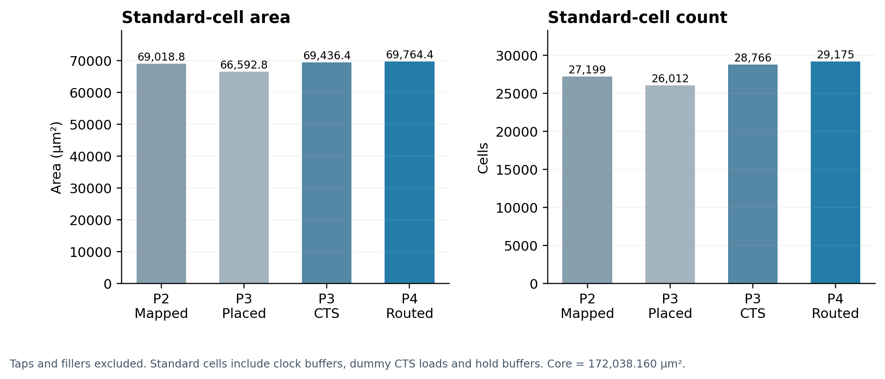
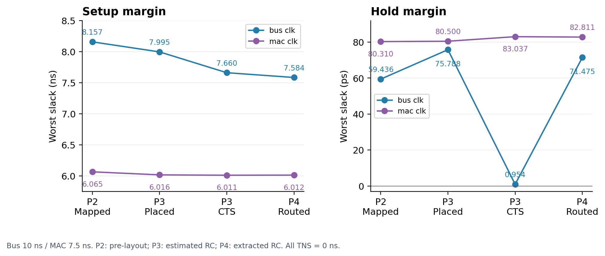

# Measured implementation results

## Configuration and provenance

RTL commit: `38d6353712ac7ba680868f0729cf9006e7bff93d`. Top: `mac_accel_dma_rob_top`. `DATA_WIDTH=16`, `AXI_DATA_WIDTH=32`, `AXI_ADDR_WIDTH=32`, `AXI_ID_WIDTH=4`, `S_AXI_ADDR_WIDTH=8`, `MAX_LEN=256`, `BURST_LEN=16`, **`MAX_OUTSTANDING=8`**. Depth 8 is explicitly selected; the RTL default is 4. No functional RTL change was made for physical implementation.

ORFS commit: `e5ce907f878490bf9947347f4cd4b73e97451c80`. Nangate45 views are the 70 hashed platform files at that revision. Actual tool revisions and file hashes are in [pins.json](pins.json). Source and final-artifact hashes link results to the exact design; run IDs and summary hashes in [summary.json](summary.json) identify the archived evidence.

## Area and instance counts

| Stage | Std. cells | Std. area (µm²) | Core (µm²) | Std. utilization | Clock buffers¹ | Hold buffers |
| --- | --- | --- | --- | --- | --- | --- |
| P2 synthesis | 27,199 | 69,018.754 | — | — | 0 | 0 |
| P3 placement | 26,012 | 66,592.834 | 172,038.160 | 38.708% | 0 | 0 |
| P3 CTS | 28,766 | 69,436.374 | 172,038.160 | 40.361% | 1302 | 595 |
| P4 routed | 29,175 | 69,764.352 | 172,038.160 | 40.552% | 1305 | 1001 |

¹ Buffers on functional register clock paths, excluding dummy loads. P3/P4 have another **857 CTS dummy load cells**, included in standard-cell count/area. P2 contains 337 mapped `CLKBUF_X1` **data buffers**, which are not a constructed clock tree. Hold buffer counts use the `hold*` instances verified against the saved OpenDB/netlist and repair logs, rather than all buffer masters.

All physical stages use the same 415.15 × 414.40 µm core, 417.39 × 417.39 µm die, and 296 standard-cell rows. Final taps: 1,039 cells / 276.374 µm². Final fillers: 40,409 cells / 101,997.434 µm². Final total: 70,623 instances; 100% occupied row area including fillers. Standard utilization excludes taps/fillers; it is not 100% functional occupancy. Register arrays map to flops, with no SRAM macro: A buffer 4,096 bits, ROB 2,048 active data bits, FIFO 528 bits.

## Setup and hold

| Stage | Bus setup WNS (ns) | Bus hold WNS (ps) | MAC setup WNS (ns) | MAC hold WNS (ps) | TNS (ns), both domains |
| --- | --- | --- | --- | --- | --- |
| P2 synthesis | +8.157001 | +59.436 | +6.065259 | +80.310 | 0 setup / 0 hold |
| P3 placement | +7.995377 | +75.788 | +6.016321 | +80.500 | 0 setup / 0 hold |
| P3 CTS | +7.660461 | +0.954 | +6.010626 | +83.037 | 0 setup / 0 hold |
| P4 routed | +7.583547 | +71.475 | +6.012479 | +82.811 | 0 setup / 0 hold |

There are zero violating setup/hold endpoints in each domain at each listed checkpoint. P2 domain TNS zeros follow from measured overall setup/hold TNS = 0; P3/P4 report per-domain TNS directly. P2 uses pre-layout timing with ideal clocks; P3 placement uses placement-estimated RC and ideal clocks; P3 CTS uses estimated RC and propagated clocks; P4 uses actual routed OpenRCX SPEF and propagated clocks. The same bus/MAC periods and I/O min/max delays remain fixed. Positive margins under these models are not frequency limits, multi-corner results or silicon measurements.

## Clock trees

| Stage / domain | Functional sinks | Clock buffers | Rise latency range (ns) | Rise spread (ps) | Fall latency range (ns) | Fall spread (ps) | Timing-path skew (ps) |
| --- | --- | --- | --- | --- | --- | --- | --- |
| P3 CTS / bus_clk | 7281 | 1264 | 0.314247–0.343584 | 29.336 | 0.332256–0.363268 | 31.013 | 27.693 |
| P3 CTS / mac_clk | 222 | 38 | 0.129517–0.140478 | 10.961 | 0.134070–0.145684 | 11.615 | 10.522 |
| P4 routed / bus_clk | 7281 | 1267 | 0.384221–0.415071 | 30.850 | 0.403148–0.435666 | 32.518 | 28.087 |
| P4 routed / mac_clk | 222 | 38 | 0.123816–0.133843 | 10.027 | 0.127563–0.138139 | 10.576 | 9.514 |

Global max–min sink latency spread and timing-path skew are distinct measurements. P3 and P4 include both rise and fall insertion delay; no clock tree is present at P2 or pre-CTS placement. P4 adds three `CLKBUF_X3` cells before the original bus root to segment a wire that failed the operative GDS antenna rules. See [hold analysis](HOLD_ANALYSIS.md) for the timing consequences.

## Electrical and physical verification

| Stage | Slew | Fanout | Capacitance | Physical checks |
|---|---:|---:|---:|---|
| P2 | 2 | 2 | 13 | Unplaced; routing DRC not run |
| P3 placement / CTS | 0 | 0 | 0 | Legal placement and PDN connectivity checked; routing/GDS DRC not run |
| P4 final | 0 | 0 | 0 | Router 0; KLayout 0 across 133 categories; GDS antenna 0 |

Detailed-router violation progression: 3,476 → 448 → 272 → 0. Final routed database reports completion; native route opens/shorts checks pass. These connectivity checks are not LVS. LEF lacks a qualified antenna ratio/gate-area model, so the native zero-antenna report is **inconclusive**. Independent KLayout GDS checks are the operative antenna evidence. Four GDS antenna violations on the first routed bus clock-input wire were repaired; thresholds and enabled rule groups remained unchanged.

## Routing and extraction

Final routed wire length: **410,557 µm**; **198,562 vias**. Global routing: zero overflow across ten layers; demand 142,128 / resource 953,760 = 14.90% aggregate usage (not detailed-route congestion or a guaranteed capacity reserve). Highest layer mean usage: M2 38.69%, M3 31.02%. Layer wire lengths are in [summary.json](summary.json).

OpenRCX extracts 36,372 nets, 149,312 resistor segments, 149,312 capacitance nodes and 276,037 coupling segments. Final SPEF is 30,928,891 bytes. Active annotated timing nets have **0 missing and 0 partial annotations**; all raw unannotated drivers are independently classified as unused inputs or unloaded outputs. Couplings below 0.1 fF are grounded by the accepted extraction configuration.

## Resources and qualification controls

| Phase | Logged command time | Peak RSS | Storage |
|---|---:|---:|---:|
| P2 | 108.35 s | 459.4 MiB | Exact archive usage available locally |
| P3 | 249.01 s | 563.9 MiB | 1,097,021,181 apparent bytes at packaging |
| P4 | 2,324.01 s / 38.73 min | 2,081.5 MiB / 2.033 GiB | 1,368,832,547 apparent bytes at sealing |

Two threads and one Make job were used. Times sum logged commands, including retries; P4 excludes nested audit/GLS double counting and includes both physical iterations. They are not session wall times or controlled tool-speed benchmarks. Complete per-command wall time/RSS/return codes are retained locally and the compact public [resource table](resources.csv) reports each recorded stage without exposing server configuration.

P1A qualified the official GCD flow through final GDS and supported checks, but **did not close the original 0.46 ns target**: setup WNS −0.0399685 ns, TNS −0.714457 ns, 36 violating endpoints. P1B qualified the standalone `mac_pe` pilot at 7.5 ns with its separate uncertainty/I/O contract. Neither is used to substitute for the full V3 measurements.

Historical OSU 0.18 µm timing/power benchmarks remain separate. No matched-process PPA comparison or Nangate45 signoff power claim is made.

## Data-repair buffer accounting

The placement, CTS and routed checkpoints retain **1,161 non-hold data buffers** with measured insertion names: 1,006 `place*`, 71 `input*`, 83 `output*`, and one `max_cap*`. Accepted placement logs record removal of all 2,366 original mapped buffer cells, insertion of the boundary buffers, and resizer repair passes. These name groups include electrical and placement repairs; they are not all attributable solely to setup timing. Counts are unchanged during P4, which adds only the 406 hold buffers and three clock-input buffers documented above.

All BUF/CLKBUF master cells: placement 1,161; CTS 3,608; routed 4,017. This total also contains 550 buffer-type dummy CTS loads; another 307 dummy load cells are inverters. The complete 857 dummy-load count is included in standard-cell area but excluded from functional clock-buffer count.
