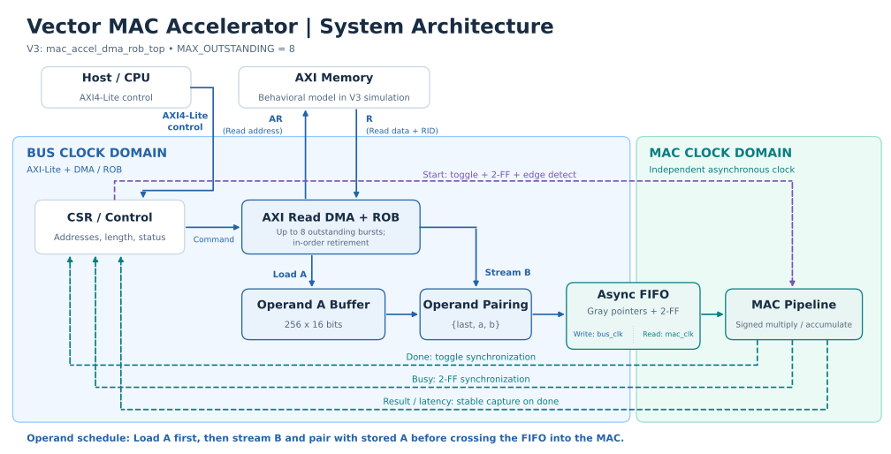
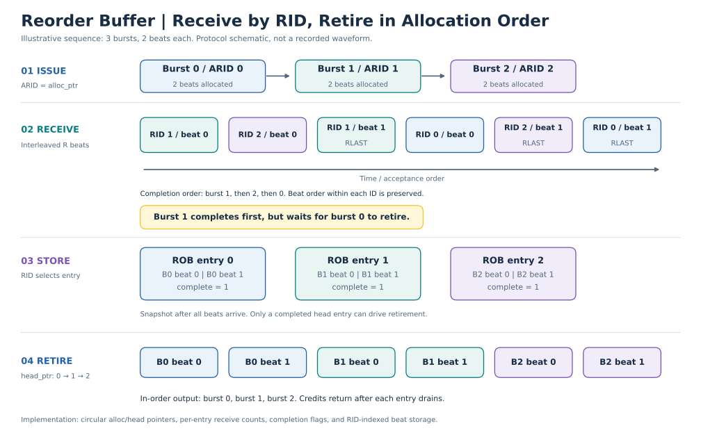
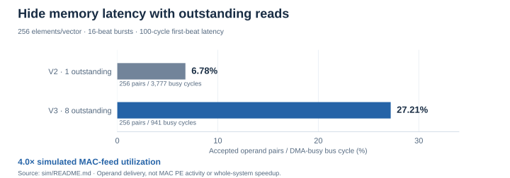
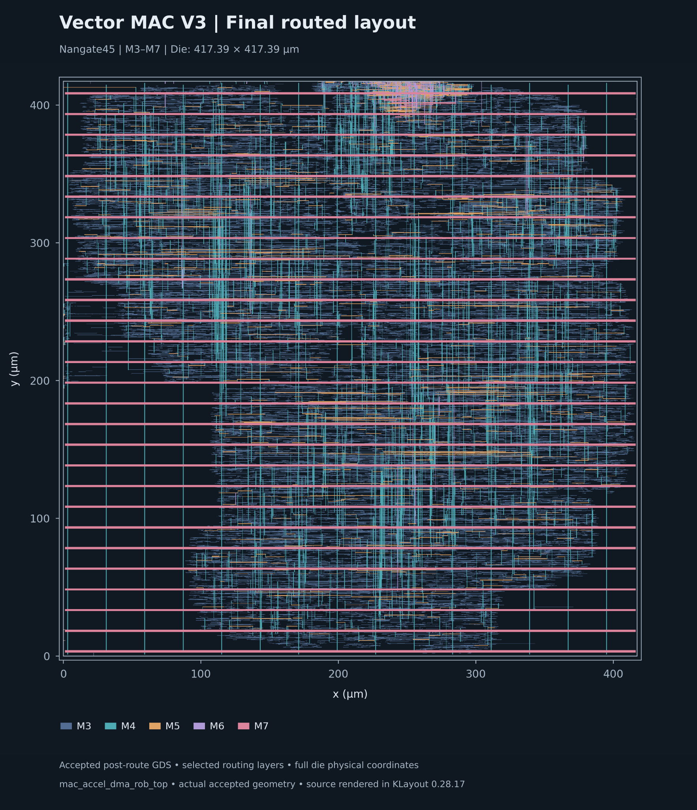
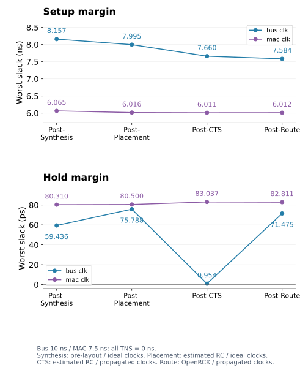

# Vector MAC Accelerator — AXI DMA, ROB, CDC & RTL-to-GDS

<a id="project-overview"></a>

A parameterized signed Vector MAC with AXI4-Lite control, a multi-outstanding
AXI read DMA, and a RID-indexed reorder buffer. V3 delivers ordered operands
across two asynchronous clock domains to a signed multiply/accumulate pipeline.
The project combines RTL scoreboards, scoped formal proofs and CDC analysis
with a completed Nangate45 OpenROAD RTL-to-GDS research implementation.

[Highlights](#engineering-highlights) · [Architecture](#architecture-and-design-decisions) ·
[Optimizations](#measured-performance-optimizations) · [Physical implementation](#physical-implementation) ·
[Verification](#verification-strategy) · [Run and reproduce](#reproduction-and-documentation)

<a id="results-at-a-glance"></a>

## Engineering highlights

| Measured accomplishment | Engineering contribution and measurement scope |
|---|---|
| **4.0× simulated MAC-feed utilization** — 6.78% → 27.21% | Overlap **1 → 8 outstanding AXI read bursts** while restoring operand order. V2/V3 simulation: 256 elements/vector, 16-beat bursts, 100-cycle first-beat latency. |
| **26.36% synthesized QoR critical-path reduction** — 5.50 → 4.05 ns | Move address arithmetic off the AR output into handshake-updated address state. **OSU 0.18 µm DMA-block synthesis**, depth 8, same 100 MHz configuration. |
| **53.59% pre-layout active dynamic power reduction** — 76.1114 → 35.3225 mW | Target clock gating to the A-operand buffer. **SAIF-driven OSU DMA-block estimate**, with identical baseline/gated activity files. |
| **Full V3 RTL-to-GDS with positive extracted setup/hold slack and zero supported DRC violations** | **Nangate45 full top**, 29,175 standard cells, 40.552% standard-cell utilization; bus 10 ns / MAC 7.5 ns. OpenRCX extraction, independent OpenSTA and supported router/KLayout checks. |

The simulation comparison, OSU block experiments and Nangate45 full-top
implementation answer different engineering questions. They are **not a
matched-process PPA comparison**; no routed Nangate45 power reduction is claimed.

<a id="architecture"></a>

## Architecture and design decisions

**Data flow:** AXI4-Lite control → AXI DMA / RID-indexed ROB → operand pairing →
asynchronous FIFO → signed MAC pipeline → result CSR.



V3 first fetches vector A into `buf_a`, then streams vector B and pairs each
beat with stored A. The `{last,a,b}` stream crosses the FIFO into the MAC;
AXI-Lite registers expose source addresses, length, start/status, result and
latency. Stalls propagate through the operand stream rather than discarding
work. Register arrays map to flops in the accepted physical implementation;
there is no SRAM macro.

| Evolution | Top module | Operand delivery and demonstrated scope |
|---|---|---|
| **V1 — CPU-fed** | `mac_accel_axi` | CPU writes through AXI4-Lite; validated on a Digilent Nexys A7-100T with MicroBlaze |
| **V2 — DMA** | `mac_accel_dma_top` | Single-outstanding AXI read DMA; behavioral AXI memory models |
| **V3 — ROB DMA** | `mac_accel_dma_rob_top` | Unique-ID outstanding bursts, OOO/interleaved receive and in-order retirement; full RTL-to-GDS implementation |

### Hide latency without losing burst ownership

A single-outstanding engine spends long intervals waiting for memory. V3 can
issue up to eight bursts before earlier responses finish, keeping useful
requests in flight. Each accepted AR request owns a ROB entry with
`ARID=alloc_ptr`; incoming R beats select storage by `RID`. Receive counts and
completion flags track each burst independently, while only the completed
`head_ptr` entry may retire.

An entry's credit returns **after its final beat drains**, rather than when
its response merely completes. This prevents reusing an ID while ordered
output still depends on the old entry. The tradeoff is ROB storage and
head-of-line blocking: a later completed burst waits for the oldest burst.
The engine accepts interleaving across IDs; beat order within each ID follows
the AXI contract.

<p align="center"></p>

*Illustrative two-beat bursts, not a recorded waveform. The diagram shows why
response completion and permission to retire are separate control decisions.*

### Cross clocks with explicit stream and event protocols

The asynchronous FIFO absorbs different bus/MAC rates and provides
backpressure. Gray-coded pointers change one bit per source increment and
cross through two-flop synchronizers before full/empty decisions. Operand
payload travels through FIFO storage; its transfer is qualified by the FIFO
protocol, rather than synchronizing each data bit independently.

| Crossing | Direction | Implemented mechanism |
|---|---|---|
| Start | bus → MAC | Toggle → 2-FF synchronization → edge detection |
| Operand pairs | bus → MAC | Async FIFO with Gray pointers and flow control |
| Done | MAC → bus | Toggle → 2-FF synchronization → edge detection |
| Busy | MAC → bus | 2-FF level synchronizer |
| Result / latency | MAC → bus | Stable bundled bus captured when synchronized done arrives |

The stable result transfer depends on the RTL protocol's hold-stability
contract. Physical CDC audits retain **13 two-stage chains**, time their
interstages, and audit **602 bounded crossings** plus three first-stage event
exceptions; these are crossing pairs, not 602 synchronizers. This is structural,
protocol and timing evidence, not analog metastability/MTBF or RDC signoff.

Integration details: [RTL map and register interface](rtl/README.md),
[CDC scenario matrix](sim/CDC_REGRESSION.md), and
[physical CDC/constraint methodology](physical/METHODOLOGY.md#cdc-groups).
V3 defaults to depth 4; published depth-8 results explicitly select
`MAX_OUTSTANDING=8`.

<a id="performance-and-optimization"></a>
<a id="performance-optimizations"></a>

## Measured performance optimizations

### 1. Overlap memory requests: 4.0× MAC-feed utilization



*256 elements/vector, 16-beat bursts, 100-cycle first-beat memory latency;
V2 has one outstanding burst and V3 has eight. MAC-feed utilization is accepted
operand pairs per DMA-busy bus cycle, not MAC PE activity or whole-system
speedup. Counts: **256/3777 → 256/941**.*

The ROB enables overlap while preserving the A/B operand sequence. A loading
and B streaming remain separate phases; eight outstanding bursts improve
operand delivery under this workload without implying continuous MAC activity.
The [measurement definition and testbenches](sim/README.md#utilization-measurement)
provide the evidence. The chart is regenerated from that accepted table by
[render_mac_feed_utilization.py](scripts/render_mac_feed_utilization.py), with
[source and output hashes](docs/figures/mac_feed_utilization.json).

### 2. Move address arithmetic off the AR output

| Before | After | Accepted synthesized result |
|---|---|---|
| `cmd_addr_r + (issue_elem << 2)` drives ARADDR | `current_ar_addr_r` advances only on `ARVALID && ARREADY` | QoR critical-path length **5.50 → 4.05 ns**, a **26.36%** reduction |

Handshake-updated state keeps AR payload stable under backpressure and removes
the long combinational address carry chain from the AR output. The optimized
global worst path moves to reset/control; this comparison uses each design's
global QoR path, not the delay of one unchanged path. Setup WNS is **+4.7923 ns**
at 100 MHz. A 100–200 MHz synthesis sweep passes setup, but the 200 MHz point
has only **+0.0389 ns** margin and exposes the flat ROB read/capture path;
100 MHz remains the canonical target.

See the [before/after engineering graphic](docs/figures/timing_optimization.svg),
[exact timing comparison](syn/README.md#first-synthesis-driven-optimization) and
[frequency characterization](syn/README.md#clock-period-sweep).

### 3. Gate the A-buffer clock

| SAIF-driven pre-layout metric | Baseline | Targeted gating |
|---|---:|---:|
| Active dynamic power | 76.1114 mW | **35.3225 mW (−53.59%)** |
| Idle dynamic power | 71.6315 mW | **30.6423 mW (−57.22%)** |
| Estimated energy per job | 221.870 nJ | **102.970 nJ** |

Power Compiler gates only the **4,096 `buf_a` register bits**. In this experiment
`buf_a` is an array of **256 16-bit storage entries**;
control, ROB, FIFO, MAC and CDC logic are outside the gating scope. Baseline
and gated designs consume identical active/idle SAIF files: a deterministic
length-64 job, 40-cycle memory latency, OOO responses/backpressure, and a
512-cycle idle window. The gated block retains **+2.4278 ns** setup WNS at
100 MHz. OSU uses discrete LATCH + AND cells rather than a dedicated ICG;
its zero-area generic latch prevents a credible gating-area claim.

See the [gating-scope graphic](docs/figures/power-gating-presentation.svg) and
[power methodology, coverage and results](syn/README.md#targeted-buf_a-clock-gating-experiment).
The presentation graphic uses storage-entry terminology;
[original figures and source provenance](docs/FIGURES.md) remain available.

**Block experiment boundary:** timing/power benchmarks target `mac_dma_rob`,
depth 8, Design Compiler R-2020.09-SP4 and `osu018_stdcells.db`, with a 10 ns
clock. They exclude the full AXI-Lite shell, async FIFO and MAC, and use ideal
clocks without CTS or extracted parasitics. The power workload's 40-cycle
latency is distinct from the utilization benchmark's 100-cycle latency.

<a id="nangate45-physical-implementation"></a>

## Physical implementation

The complete `mac_accel_dma_rob_top` was independently synthesized for
Nangate45, then implemented through floorplanning, placement, CTS, detailed
routing, OpenRCX extraction and GDS using pinned OpenROAD Flow Scripts.
This full-top run uses `DATA_WIDTH=16`, `MAX_OUTSTANDING=8`, and asynchronous
bus/MAC periods of **10 ns / 7.5 ns**.

<p align="center"></p>

*Actual accepted post-route GDS, full 417.39 × 417.39 µm die. M3–M7 metal is selected
for readability; lower metal, vias and FEOL are omitted. The image shows routed
geometry, not illustrative placement or clock-tree flylines.*

| Accepted full V3 — typical 1.1 V / 25 °C | Final measured result |
|---|---|
| Standard cells / standard-cell utilization | **29,175 / 40.552%**, excluding taps and fillers |
| Standard-cell / core area | 69,764.352 / 172,038.160 µm² |
| Extracted bus setup / hold WNS | **+7.583547 ns / +71.475 ps** |
| Extracted MAC setup / hold WNS | **+6.012479 ns / +82.811 ps** |
| Setup/hold TNS and violating endpoints | **0 ns / 0**, both clock domains |
| Supported router / KLayout DRC; operative GDS antenna | **0 / 0 / 0 markers**; KLayout covers 133 supported rule categories |
| Electrical violations | **0** slew / fanout / capacitance |
| CDC audit / final functional gate-level regression | **13 two-stage chains; 602 bounded crossings; 7/7 targeted zero-delay cases PASS** |



*Same bus 10 ns / MAC 7.5 ns contract across stages. Post-Synthesis: ideal-clock pre-layout;
Post-Placement: estimated RC/ideal clocks; Post-CTS: estimated RC/propagated clocks;
Post-Route: routed OpenRCX SPEF/propagated clocks. TNS is zero throughout. These margins
are neither frequency limits nor a comparison with the OSU experiments.*

### Hold closure from CTS to routing

Bus hold WNS moves from **+0.954 ps Post-CTS to +71.475 ps Post-Route**.
Post-route repair adds **406 data hold buffers** and **three clock-input buffers** to segment
a bus input wire that failed the operative GDS antenna checks. The worst
endpoint changes from `ROB[52][6]` to `ROB[37][1]`, so subtracting the two WNS
values alone cannot explain one path's improvement.

Matched-path analysis finds added hold-buffer chains dominate the measured
data-delay increase; the added clock-input buffers also increase capture
latency, which reduces I/O hold margin for fixed data arrival. The CTS/final
SDCs remain byte-identical. This is measured checkpoint analysis with estimated
versus extracted RC, not a same-RC counterfactual or a claim of improved skew.

Continue with [matched-path hold decomposition](physical/HOLD_ANALYSIS.md),
[physical design decisions and trade-offs](physical/README.md#physical-design-decisions-and-trade-offs),
[detailed PPA, area/cell-count evolution and routing](physical/RESULTS.md),
[routed-metal close-up](physical/README.md#routed-metal-detail), and
[placement / power-grid views](physical/README.md#placement-and-power-distribution).
Standalone OpenSTA independently checks the final netlist, SDC and SPEF;
[methodology and coverage](physical/METHODOLOGY.md) define the supported scope.

<a id="verification"></a>

## Verification strategy

| Verification layer | What it tests | Recorded evidence and boundary |
|---|---|---|
| RTL simulation / scoreboards | AR geometry/stability, request/beat conservation, RID placement, A/B pairing and payload/last under stalls | ROB **12/12**, DMA wrapper **11/11**, V3 full top **7/7**, power workload **4/4**; [test map](sim/README.md#regression-evidence) |
| AXI OOO / interleaving / backpressure | Later IDs may complete first; ordered retirement and ownership survive stalls | Behavioral memory models and protocol scoreboards; legal per-ID beat order, no commercial memory subsystem |
| Formal control safety | DMA backpressure, FIFO Gray/overflow/underflow, ROB ownership/order/count/error properties | BMC + prove PASS; ROB IC3/PDR prove/cover PASS in reduced configurations with legal AXI assumptions; [proof scope](formal/STUDY_GUIDE.md) |
| Dual-clock CDC | Payload conservation, event toggles, Gray-pointer behavior, reset-release/phase/rate scenarios | **36/36 jobs per simulator** with Icarus/VCS; six scenarios × six consecutive jobs; [scenario matrix](sim/CDC_REGRESSION.md) |
| Whole-top OSU DC / PrimeTime | Mapped dual-clock timing, CDC connectivity and all 13 two-flop chains | Bus/MAC setup/hold: **0 violations** in a single-corner ideal-clock model; [coverage and timing](syn/whole_top/RESULTS.md) |
| Nangate45 mapped / routed GLS | Targeted full-top integration on qualified functional cell models | Exact final routed netlist **7/7 PASS, zero-delay**; not SDF timing simulation or exhaustive equivalence |
| Post-route independent STA / physical checks | Final Verilog/SDC/SPEF, annotation, clocks, CDC bounds, electrical checks and supported routing/GDS rules | Positive extracted setup/hold, zero supported DRC/antenna/electrical violations; [physical methodology](physical/METHODOLOGY.md) |
| GitHub-hosted CI | Full-top/fast RTL, CDC matrix, syntax, validator unit tests and documentation/hash checks | Published commit `37c926a`: **[hosted run PASS](https://github.com/szuwei-yeh/mac-accel-cdc/actions/runs/38174881093)**; [workflow](.github/workflows/rtl-ci.yml), [local instructions](docs/CI.md) |

Formal evidence establishes scoped control properties under its model; full
V3 formal equivalence is not established. OSU whole-top PT worst setup slack
is **+5.114273 ns (bus) / +0.020727 ns (MAC)** and hold slack is
**+0.049906 / +0.214744 ns**. The 20.727 ps MAC setup margin belongs to that
pre-layout OSU model, not the routed Nangate45 result. OSU mapped GLS remains
inconclusive due to cell-model unknown-state behavior, also seen in the baseline.

The hosted result above is for the linked published commit. Lightweight CI does
not rerun formal, mapped GLS, synthesis or physical implementation.

<a id="reproduction-and-limitations"></a>

## Reproduction and documentation

### Quick start

Run from the repository root with Icarus Verilog installed:

```bash
# Full V3: AXI-Lite → DMA/ROB → async FIFO → MAC → result CSR
iverilog -g2012 -DV3_MAX_OUT=8 -s tb_mac_accel_dma_rob_top \
  -o /tmp/mac_accel_dma_rob_top \
  sim/tb_mac_accel_dma_rob_top.v rtl/mac_accel_dma_rob_top.v \
  rtl/mac_dma_rob.v rtl/axi_read_engine_rob.v rtl/mac_pe.v \
  rtl/mac_fifo_async.v sim/axi_read_mem_model_ooo.v
vvp /tmp/mac_accel_dma_rob_top
```

Expected: **7 PASS / 0 FAIL**. Other
[depth-8 RTL regressions](sim/README.md#depth-8-rob-and-dma-regressions),
[CDC matrix](sim/CDC_REGRESSION.md), [formal tasks](formal/STUDY_GUIDE.md),
[block synthesis](syn/README.md#canonical-baseline-flow),
[SAIF/gating reproduction](syn/README.md#reproduction),
[whole-top DC](syn/whole_top/DC_FLOW.md) and [PrimeTime](syn/whole_top/PT_FLOW.md)
retain their detailed commands. Synopsys flows require licensed tools and the
specified OSU library; the physical flow requires externally supplied pinned
OpenROAD/ORFS tools and Nangate45 inputs.

<a id="repository-map"></a>

### Repository navigation

| Start here | Documentation / evidence |
|---|---|
| [RTL design](rtl/README.md) | Module map, accelerator versions and register interface |
| [Simulation / scoreboards](sim/README.md) | AXI memory models, regression cases and utilization definition |
| [Formal verification](formal/STUDY_GUIDE.md) | Properties, reduced configurations, assumptions and proof commands |
| [Synthesis / optimizations](syn/README.md) | Block timing, frequency sweep, SAIF and targeted gating |
| [Whole-top DC / PT](syn/whole_top/README.md) | Dual-clock mapped timing and constraint coverage |
| [Physical implementation](physical/README.md) | Accepted layouts, result tables, provenance and verification limits |
| [Physical reproduction](physical/REPRODUCE.md) | Pinned inputs, commands and experimental adapter acceptance limits |
| [CI instructions](docs/CI.md) / [CI runs](https://github.com/szuwei-yeh/mac-accel-cdc/actions) | Hosted checks and matching local commands |
| [Figure sources and regeneration](docs/FIGURES.md) | Accepted data sources, immutable original figures and new utilization chart recipe |
| [GitHub metadata proposals](docs/GITHUB_METADATA.md) | Description and topics |

<a id="design-scope-and-limitations"></a>

### Research-flow limitations

Qualified **LVS is unsupported**; Nangate45 timing is **single-corner**, with
zero clock uncertainty and the documented I/O/reset contract. Native LEF
antenna checks remain **inconclusive**; supported GDS checks provide the
operative antenna evidence. A **fresh portable RTL-to-GDS replay remains
untested**, although the accepted archived implementation and repaired artifact
acceptance path were validated. Multi-corner/OCV, foundry signoff, LEC, SDF,
CDC MTBF/RDC, dynamic IR/EM and signoff power remain outside the demonstrated
scope; see [physical methodology](physical/METHODOLOGY.md#achieved-scope) and
[adapter acceptance limits](physical/REPRODUCE.md#experimental-adapter-acceptance-limits).

The AXI master is read-only AR/R and does not split bursts at 4 KB boundaries;
callers must keep each burst within a page. OSU timing and SAIF power remain
pre-layout estimates; the zero-area latch prevents a credible gating-area
comparison. V2/V3 use behavioral memory models, and the full V3 physical result
is research evidence rather than a silicon or system-level performance claim.
